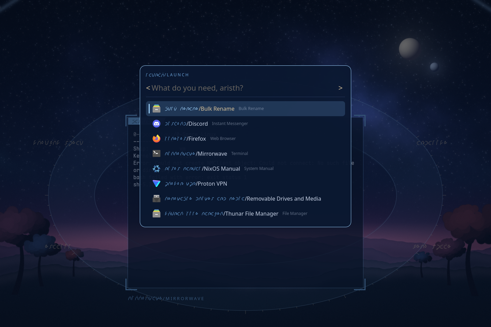
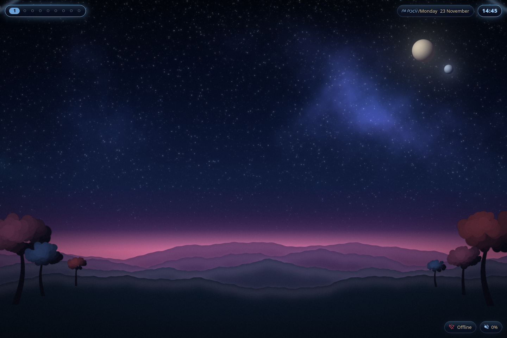
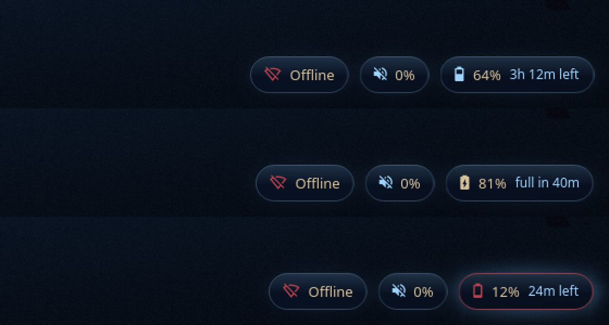
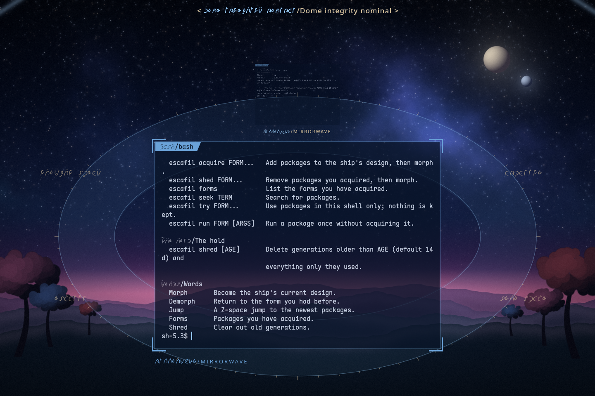
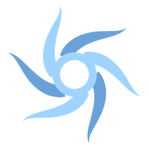
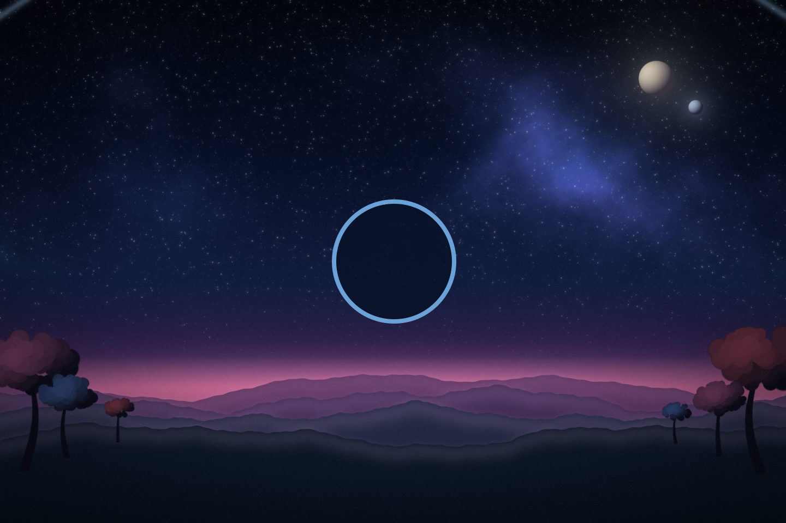

# 0-Space Linux

> `< Dome integrity nominal. All engines report ready. >`

An Andalite war-cruiser for a desktop, built on NixOS.

- **The carousel**: a Wayfire plugin of our own. Windows stand on a ring that
  runs back into the screen, seen from slightly above. The front window is full
  size; the others recede round the ring in perspective, smaller, higher and
  dimmer with distance, and squashed side-on round the sides. Spinning brings
  the next one round to the front. No title bars, no window chrome.
- **The Dome**: the view from inside a Dome ship, as the background: the
  dome's ribs overhead against a starry nebula, a banded gas giant and its
  moon, lit rim lights along the horizon, misty hills and a lake, and
  blue, violet and teal Andalite trees at the sides, leaving the middle
  calm for the carousel (`art/dome.png`, painted by `tools/render-dome.py`).
  Running `python3 tools/render-dome.py out.png W H` paints it at any size.
- **The ring floor**: the carousel's ring in perspective under the windows,
  marked in the script, with every window named and the front one bracketed.
- **The script**: an invented alphabet. Thought-speak, window names and the
  ring's markings are written in it, with plain English underneath.
- **Thought-speak**: notifications float at the top, `< like this >`.
- **The morph limit**: at one hour fifty minutes, the ship tells you to demorph.
- **Idle lock**: locks after 9 minutes idle and always before sleep.
- **Liberated systemd**: systemd without the `birthDate` user-record field.
- **escafil**: the operator. One short command for every job.
- No Flatpak: everything comes from nixpkgs.
- **The readout**: every new Mirrorwave window opens with fastfetch, themed:
  the 0-Space logo as a picture, every label as `<script>/English` (Hull,
  Mind, Sight, Hold, Z-space, Morphed…), and `< Dome integrity nominal. >`.
  On a text console the logo is drawn in characters. Made by
  `tools/make-fastfetch.py` into `theme/fastfetch/`.
- **The everyday kit**: git, wget, curl, fastfetch, btop, jq, tree, file,
  zip/unzip/7z, lspci/lsusb/lsof and pavucontrol; Bluetooth (blueman), the
  network and Bluetooth applets in the tray, removable drives, the GNOME
  keyring for saved passwords, and a polkit prompt for admin rights.
- **Lean running**: zram swap (zstd, half of RAM), no waiting for the network
  at boot, no NixOS manual built into every generation, no speech daemon, a
  capped journal, weekly TRIM, thermald, and generations older than two
  weeks cleared weekly. The shell loads one Dome image at the screen's size
  and only draws its fallback when there's no art; glass repaints are batched.

## escafil

```
escafil scan              kernel, generation, packages date, Wi-Fi, power, disk
escafil doctor            scan, plus failed services and network
escafil morph             rebuild the ship from its design and switch to it
escafil jump              update to the newest packages, then morph
escafil demorph           go back to the previous generation
escafil generations       list the generations you can go back to
escafil acquire FORM...   add packages, then morph
escafil shed FORM...      remove packages you acquired, then morph
escafil forms             list what you've acquired
escafil seek TERM         search for packages
escafil try FORM...       use packages in this shell only
escafil run FORM [ARGS]   run a package once
escafil shred [AGE]       clear generations older than AGE (default 14d)
escafil record [NAME]     keep a copy of the ship's design and state
escafil edit              open this ship's design
escafil orders            all of the above
```

## Controls

**Workstations**

| Keys | Order |
|---|---|
| Super+1 to 9 | Go to a workstation (each has its own carousel) |
| Super+Shift+1 to 9 | Take the front window to a workstation |
| Super+Tab | Stalk-eye overview: every window laid out flat |
| Super+Left / Super+Right | Spin the carousel |

**Applications**

| Keys | Opens |
|---|---|
| Super+Space | The launcher: type, Up/Down, Enter |
| Super+T | Mirrorwave (terminal) |
| Super+W | Firefox |
| Super+D | Discord |
| Super+V | VLC |
| Super+E | Thunar (files) |
| Super+A | ani-cli, in Mirrorwave |
| Super+P | Proton VPN |
| Super+S | `escafil scan` |
| Super+B | Keep the corners out, or let them tuck away again |
| Super+Escape | Power menu: lock, suspend, log out, restart, power off |

**Windows**

| Keys | Order |
|---|---|
| Super+Q | Close the front window |
| Super+F | Toggle the front window between full width and 50% |
| Super+R | Cycle the front window's width: 33, 50, 67 or 100% |
| Super+Shift+F | True fullscreen |
| Super+Shift+Space | Float the window above the carousel, or put it back |
| Super+left drag | Move a window (a carousel window floats where it is first) |
| Super+right drag | Resize a window from its nearest corner (floats it too) |

Clicking any window on the carousel spins it round to the front.

**Session, screen and keyboard**

| Keys | Order |
|---|---|
| Super+X / Super+Z | Lock / suspend |
| Super+Shift+S | Select a region, then mark it up in swappy |
| Alt+Shift | Switch keyboard layout (gb and ru) |
| Volume, mute, mic mute | Change the level, shown as a gauge at the bottom |
| Brightness up / down | The same, for the screen |



## The corners

No bar: glass pills in the corners of the screen, frosted over the Dome,
with a soft fur-blue glow.

| Corner | Pills |
|---|---|
| Top left | Workstations (the current one a glowing capsule, ones with windows a filled dot; click or scroll to go) and the front window's name |
| Top right | The day, as `<script>/Monday`, the date, the time, and power (lock, suspend, log out, restart, power off; restart and power off ask twice) |
| Bottom right | Battery (hover for time left, or time to full; red when low), sound (click to mute, scroll for volume), network (click for `nmtui`) and the tray (left click opens, right click for the menu) |

They stay out while the workstation is empty and in the overview. Once a
window is open they tuck away; touch a corner with the pointer to bring
that corner back, or Super+B to keep them all out. Changing workstation
shows the top-left corner for a moment, and a low battery keeps the
bottom-right one out.

The glass is the Dome itself, blurred: `art/dome-glass.png`, made by
`tools/render-glass.py`. A Dome of your own is frosted the same way when you
log in. The pills, the launcher, the power menu and the volume display are
all frosted panes: the Dome behind them, a thin tint, a sheen across the
top, a glow along the bottom and a bright rim. The launcher and power menu
lay a frosted veil over the screen behind them.

Windows are glass too: the GTK theme's window, view and sidebar colours
are see-through, Mirrorwave is at 66% opacity, and Wayfire blurs behind
every window (`blur_by_default = type is "toplevel"` in `wayfire.ini`).





## Hardware

Laptops get their model's module from
[nixos-hardware](https://github.com/NixOS/nixos-hardware). The installer
recognises Framework laptops by their processor and writes the right one
into the new host; the reference host is a Framework Laptop 13 Pro:

```nix
inputs.nixos-hardware.nixosModules.framework-intel-core-ultra-series3
```

That brings firmware updates (fwupd), the fingerprint reader, power tuning,
`framework_tool`, and Framework's embedded-controller kernel module (battery
charge limit, LEDs). Both of those come prebuilt from the NixOS cache.

## How it's built

A dendritic flake: every file in `modules/` is a flake-parts module, picked up
automatically by import-tree. Each feature is one file:

| File | What it is |
|---|---|
| `modules/features/base.nix` | Boot, kernel, firmware, network, sound, the user |
| `modules/features/liberated-systemd.nix` | systemd without `birthDate` |
| `modules/features/carousel.nix` | The Wayfire plugin, packaged and loaded |
| `modules/features/dome.nix` | The session: Wayfire, the shell, greetd autologin |
| `modules/features/forms.nix` | Packages acquired with `escafil` |
| `modules/features/escafil.nix` | The operator |
| `modules/features/branding.nix` | What the ship calls itself |
| `modules/features/mirrorwave.nix` | Mirrorwave, the terminal |
| `modules/features/apps.nix` | The standard apps, and the commands the keys use to reach the shell |
| `modules/features/theme.nix` | Everything else's look: boot menu, splash, consoles, login, apps, lock |
| `modules/flake/hosts.nix` | Every folder in `hosts/` becomes a machine |
| `modules/flake/installer.nix` | The installer ISO |

Each machine has a folder in `hosts/`: its hardware, its user, and its forms
list. The installer writes one for the machine it installs to, and the
installed ship keeps its design in `/etc/0space`.

### Liberated systemd without rebuilds

Patching systemd normally changes the identity of everything built against
it, so Nix would rebuild a large part of the system. Instead, the system
comes from the binary cache as usual and `system.replaceDependencies` swaps
the patched systemd in afterwards. Only systemd itself is compiled, once per
systemd version. The patch only removes code, so the swap is safe.

The initrd is a compressed archive the swap can't reach, and its systemd is
PID 1 until the real system takes over, so it's given the liberated build
directly. Both PID 1s are liberated.

## Theme

One Andalite palette (night navy, fur blue and tan, dome glass, the pink of
home's trees) runs through everything you see:

| Where | What |
|---|---|
| Boot menu | Limine over the Dome, "0-Space Linux" in fur tan, palette in its terminal |
| Boot splash | Plymouth: the Dome, the title, `< Dome integrity nominal >`, lights orbiting as a carousel; the disk password prompt is thought-speak |
| Consoles | The palette on every text console |
| Login | tuigreet: `< Welcome back to the Dome >` (only when autologin is off or you log out) |
| Terminal | Mirrorwave (below) |
| Apps | The 0Space GTK theme (theme/gtk: glass buttons and fields with a fur-blue glow, glowing menus, fur-blue selection) for GTK 3, the same for GTK 4, Qt to match, Papirus icons, Bibata cursor |
| Firefox | Dark, no welcome pages, no telemetry |
| Lock | swaylock over the Dome with a fur-blue ring |

## Mirrorwave

The ship's terminal, named for the Andalite mass call. kitty is the engine
underneath, so nothing is compiled; Mirrorwave is its own name and window,
and the Andalite look:

- **Andalite/English.** Tab titles read `<script>/bash`. escafil does the
  same in Mirrorwave: `<script>/0-Space Linux`, `< <script>/Morph complete >`.
  In a text console or another terminal it prints only the English.
- **Thought-speak when work finishes**: a command that takes more than ten
  seconds tells you when it's done, if you've looked away.
- **See-through** over the Dome.
- **Full Andalite** (**Ctrl+Alt+A**): every letter in the script.
  **Ctrl+Alt+L** returns to English.

Your own settings go in `~/.config/mirrorwave/mirrorwave.conf` (kitty's
format).



### The script

The Andalite script is a real font, `0-Space Script` (`art/0space-script.ttf`),
drawn by `tools/make-script-font.py`. Every letter grows from one of eight
forms (crescents, the tail's S-curve, a cloven hoof, a teardrop, an arch, a
bowl, a bladed spine) and is told apart by its marks: stalk eyes, a core dot,
a slash, a trailing tail. Capitals are taller, with a crown stroke. Anything
written in it is English underneath, so you can learn to read it.

Everywhere it appears, it's a translation beside the English, written
`<script>/English`: window names, thought-speak, Mirrorwave's tabs and
escafil's headings.


GTK 4 apps read `~/.config/gtk-4.0/gtk.css`; the session links it to the
system's copy, so theme updates reach you. Put your own file there and it's
left alone.

### Scale

At login each screen's scale is picked from its pixel density: 2× on the
Laptop 13 Pro's 2.8K panel, 1× on an ordinary monitor. To choose yourself,
put a number in `~/.config/0space/scale` (say `1.5`).

### The logo

A hollow zero with six Andalite tail blades (`art/logo.svg`, drawn by
`tools/render-logo.py`). It's on the boot splash, in fastfetch, and installed
as the system's logo icon.





## Installing

**1. Get the ISO.** GitHub builds it: open the repository's **Actions** tab,
choose **ISO**, open the newest run that has a green tick, and download
**0space-linux-iso** under *Artifacts* (a zip holding the ISO and its
checksum; about 3.6 GB). To build a fresh one, press **Run workflow** on the
same page (or push to the `iso` branch); it takes about an hour and nothing is compiled on your machine.

**2. Write it to a USB stick** (8 GB or more; it will be wiped). On Windows,
use [Rufus](https://rufus.ie): pick the ISO, and when Rufus asks how to write
it, choose **DD image mode**. balenaEtcher works too, with no choices to make.

**3. Turn off Secure Boot.** The boot menu (Limine) isn't signed. On a
Framework, press **F2** at power-on, then *Security* → *Secure Boot* → off.

**4. Boot the stick.** Press **F12** at power-on and pick the USB stick. The
installer starts by itself:

1. Connect to Wi-Fi when asked. The Dome needs a short connection to fetch
   the parts made for your machine.
2. Choose the disk. **Everything on it is erased**: no dual boot.
3. Name the ship, then give your login name and password.
4. Wait while the Dome is assembled (a few minutes), then restart and take
   the stick out.

Framework laptops get their hardware module automatically. After that,
everything is `escafil`: `escafil scan` to look round, `escafil jump` to
update to the newest 0-Space (your ship's own design in `hosts/` is kept).

### Building it yourself

In WSL (ArchWSL is fine) or on any Linux:

```sh
git clone https://github.com/factionparadox/0SpaceLinux
0SpaceLinux/tools/build-iso
```

It installs Nix first if needed and builds the ISO into the repo folder as
`0space-linux.iso`. The first build compiles the liberated systemd and
downloads the rest from the NixOS cache; after that, builds reuse what's
already built. To rebuild after changes: `git pull`, then
`tools/build-iso` again.

## Status

Tested, on nixos-unstable (systemd 262, Wayfire 0.10.1, Quickshell 0.3.2):

- The flake evaluates, and the carousel plugin builds as a Nix package.
- The full system builds. Both PID 1s (initrd and system) are the liberated
  systemd: `birthDate` appears in neither, and NixOS's stock systemd is gone
  from the system.
- The theme: Mirrorwave (translated tab titles, escafil's translated
  headings) and swaylock checked in the running session (screenshots above).
- The built session runs: Wayfire with the carousel, the shell with the Dome,
  ring floor, names in the script and thought-speak. See `docs/ring-headless-test.png`.
- A machine set up the way the installer writes it builds with only small
  local steps, reusing the liberated systemd, and acquired forms install.
- The ISO builds and boots into the installer, which reaches its network
  step. A full install hasn't been run end to end: this test machine's
  network can't be used from inside a VM, so the first full install will be
  on real hardware.
- escafil and the installer pass shellcheck at its strictest level.

Not yet tested:

- A complete install, start to finish. The test VM couldn't reach the cache
  through the sandbox's network.
- Real hardware: the Framework's Wi-Fi, graphics, suspend and the idle lock.
- The corners: shown on an empty workstation, tucked away when a window
  opens, the top left peeking on a workstation change, switching
  workstation through the carousel's pipe, and a tray icon (nm-applet)
  appearing in its pill, all checked in the test session. Hovering a corner
  and the tray's menus need real input; the battery pill needs a battery.
- Wayfire's blur behind windows needs a GPU (the test session has none;
  Wayfire skips the plugin there and carries on), so the see-through GTK
  windows were checked unblurred.
- The keybindings (they need real input), including floating and Super+drag,
  the media keys and Mirrorwave's English/Andalite switch. The launcher and
  the level gauge were opened from the command line in the test session.
- The boot menu, boot splash, login screen and GTK/Qt apps haven't been seen
  running yet; they build, but the test VM boots the installer, not an
  installed system.
- Two other copies of stock systemd's code remain in the system's store:
  plain `systemd` and `systemd-minimal`, which a few packages depend on. They
  don't run the system or its logins. Swapping them too would mean two more
  systemd compiles per systemd version.

## Art

`art/dome.png` is the default Dome. Your own
`~/.local/share/0space/art/dome.png` takes priority over it.
