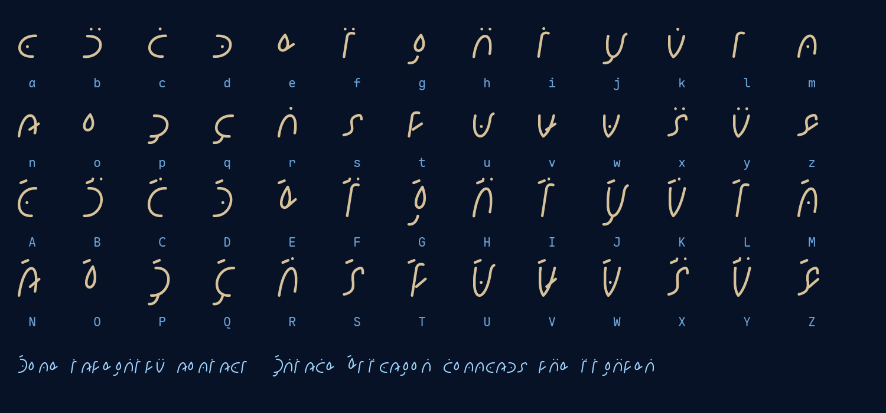

# 0-Space Linux

> `< Dome integrity nominal. All engines report ready. >`

An Andalite war-cruiser for a desktop, built on NixOS.

- **The carousel**: a Wayfire plugin of our own. Windows stand on a ring that
  runs back into the screen, seen from slightly above. The front window is full
  size; the others recede round the ring in perspective, smaller, higher and
  dimmer with distance, and squashed side-on round the sides. Spinning brings
  the next one round to the front. No title bars, no window chrome.
- **The Dome**: the biosphere you carry with you, as the background: night
  sky, nebula, two moons, the dome's glass rim, hills in mist, and the red,
  blue and pink trees of home (`art/dome.png`, rendered by `tools/render-dome.py`).
- **The ring floor**: the carousel's ring in perspective under the windows,
  marked in the script, with every window named and the front one bracketed.
- **The script**: an invented alphabet. Thought-speak, window names and the
  ring's markings are written in it, with plain English underneath.
- **Thought-speak**: notifications float at the top, `< like this >`.
- **The morph limit**: at one hour fifty minutes, the ship tells you to demorph.
- **Idle lock**: locks after 9 minutes idle and always before sleep.
- **Liberated systemd**: systemd without the `birthDate` user-record field.
- **escafil**: the operator. One short command for every job.
- No Flatpak: everything comes from nixpkgs.

## escafil

```
escafil scan              kernel, generation, packages date, Wi-Fi, power, disk
escafil doctor            scan, plus failed services and network
escafil morph             rebuild the ship from its design and switch to it
escafil jump              update to the newest packages, then morph
escafil demorph           go back to the previous generation
escafil generations       list the generations you can go back to
escafil acquire FORM...   add packages, then morph
escafil shed FORM...      remove packages you acquired, then morph
escafil forms             list what you've acquired
escafil seek TERM         search for packages
escafil try FORM...       use packages in this shell only
escafil run FORM [ARGS]   run a package once
escafil shred [AGE]       clear generations older than AGE (default 14d)
escafil record [NAME]     keep a copy of the ship's design and state
escafil edit              open this ship's design
escafil orders            all of the above
```

## Controls

| Keys | Order |
|---|---|
| Super+Left / Super+Right | Spin the carousel |
| Super+Tab | Stalk-eye overview: every window laid out flat |
| Super+R | Cycle the front window's width: 33, 50, 67 or 100% |
| Super+F | Toggle the front window between full width and 50% |
| Super+Shift+F | True fullscreen |
| Super+Q | Close the front window |
| Super+1 to 9 | Go to a workspace (each has its own carousel) |
| Super+Shift+1 to 9 | Take the front window to a workspace |
| Super+T / Super+W | Terminal / browser |
| Super+S | `escafil scan` |
| Super+Shift+S | Record a region of the screen |
| Super+X / Super+Z | Lock / suspend |

Clicking any window on the carousel spins it round to the front.

## How it's built

A dendritic flake: every file in `modules/` is a flake-parts module, picked up
automatically by import-tree. Each feature is one file:

| File | What it is |
|---|---|
| `modules/features/base.nix` | Boot, kernel, firmware, network, sound, the user |
| `modules/features/liberated-systemd.nix` | systemd without `birthDate` |
| `modules/features/carousel.nix` | The Wayfire plugin, packaged and loaded |
| `modules/features/dome.nix` | The session: Wayfire, the shell, greetd autologin |
| `modules/features/forms.nix` | Packages acquired with `escafil` |
| `modules/features/escafil.nix` | The operator |
| `modules/features/branding.nix` | What the ship calls itself |
| `modules/features/mirrorwave.nix` | Mirrorwave, the terminal |
| `modules/features/theme.nix` | Everything else's look: boot menu, splash, consoles, login, apps, lock |
| `modules/flake/hosts.nix` | Every folder in `hosts/` becomes a machine |
| `modules/flake/installer.nix` | The installer ISO |

Each machine has a folder in `hosts/`: its hardware, its user, and its forms
list. The installer writes one for the machine it installs to, and the
installed ship keeps its design in `/etc/0space`.

### Liberated systemd without rebuilds

Patching systemd normally changes the identity of everything built against
it, so Nix would rebuild a large part of the system. Instead, the system
comes from the binary cache as usual and `system.replaceDependencies` swaps
the patched systemd in afterwards. Only systemd itself is compiled, once per
systemd version. The patch only removes code, so the swap is safe.

The initrd is a compressed archive the swap can't reach, and its systemd is
PID 1 until the real system takes over, so it's given the liberated build
directly. Both PID 1s are liberated.

## Theme

One Andalite palette (night navy, fur blue and tan, dome glass, the pink of
home's trees) runs through everything you see:

| Where | What |
|---|---|
| Boot menu | Limine over the Dome, "0-Space Linux" in fur tan, palette in its terminal |
| Boot splash | Plymouth: the Dome, the title, `< Dome integrity nominal >`, lights orbiting as a carousel; the disk password prompt is thought-speak |
| Consoles | The palette on every text console |
| Login | tuigreet: `< Welcome back to the Dome >` (only when autologin is off or you log out) |
| Terminal | Mirrorwave (below) |
| Apps | GTK 3 and 4 dark (adw-gtk3/libadwaita) recoloured with the palette, Qt to match, Papirus icons, Bibata cursor |
| Firefox | Dark, no welcome pages, no telemetry |
| Lock | swaylock over the Dome with a fur-blue ring |

## Mirrorwave

The ship's terminal, named for the Andalite mass call. kitty is the engine
underneath, so nothing is compiled; Mirrorwave is its own name and window,
the Andalite look and these:

- **Translated titles.** Every tab title is written in the script, then in
  English. escafil does the same in Mirrorwave: a faint Andalite line above
  each heading and each thought-speak line.
- **Mass call** (**Ctrl+Alt+M**): what you type goes to every Mirrorwave
  window at once. All windows share one instance so the call reaches them all.
- **Thought-speak when work finishes**: a command that takes more than ten
  seconds tells you when it's done, if you've looked away.
- **See-through** over the Dome.
- **Full Andalite** (**Ctrl+Alt+A**): every letter in the script.
  **Ctrl+Alt+L** returns to English.

Your own settings go in `~/.config/mirrorwave/mirrorwave.conf` (kitty's
format).


### The script

The Andalite script is a real font, `0-Space Script` (`art/0space-script.ttf`),
drawn by `tools/make-script-font.py`. Every letter grows from one of eight
forms (crescents, the tail's S-curve, a cloven hoof, a teardrop, an arch, a
bowl, a bladed spine) and is told apart by its marks: stalk eyes, a core dot,
a slash, a trailing tail. Capitals are taller, with a crown stroke. Anything
written in it is English underneath, so you can learn to read it. The shell's
labels and thought-speak use the same font.



The GTK colours are copied to `~/.config/gtk-3.0` and `gtk-4.0` on first
login, so they're yours to change.


## Building the ISO

On a machine with Nix (flakes on):

```
nix build .#iso
```

The ISO (about 3 GB) is in `result/iso/`. It boots straight into the
installer, which asks for a disk, a ship's name, your name and a password.
Almost everything installs from the stick. The few parts made for the machine's
own hardware are fetched from the NixOS cache, so the installer connects first
(with a Wi-Fi step if needed). It's a small download.

Building the ISO compiles systemd once (the liberated version) and downloads
the rest from the NixOS cache.

## Status

Tested, on nixos-unstable (systemd 262, Wayfire 0.10.1, Quickshell 0.3.2):

- The flake evaluates, and the carousel plugin builds as a Nix package.
- The full system builds. Both PID 1s (initrd and system) are the liberated
  systemd: `birthDate` appears in neither, and NixOS's stock systemd is gone
  from the system.
- The theme: Mirrorwave (translated tab titles, escafil's translated
  headings) and swaylock checked in the running session (screenshots above).
- The built session runs: Wayfire with the carousel, the shell with the Dome,
  ring floor, names in the script and thought-speak. See `docs/ring-headless-test.png`.
- A machine set up the way the installer writes it builds with only small
  local steps, reusing the liberated systemd, and acquired forms install.
- The ISO builds and boots into the installer.
- escafil and the installer pass shellcheck at its strictest level.

Not yet tested:

- A complete install, start to finish. The test VM couldn't reach the cache
  through the sandbox's network.
- Real hardware: the Framework's Wi-Fi, graphics, suspend and the idle lock.
- The keybindings (they need real input), including the mass call and
  Mirrorwave's English/Andalite switch.
- The boot menu, boot splash, login screen and GTK/Qt apps haven't been seen
  running yet; they build, but the test VM boots the installer, not an
  installed system.
- Two other copies of stock systemd's code remain in the system's store:
  plain `systemd` and `systemd-minimal`, which a few packages depend on. They
  don't run the system or its logins. Swapping them too would mean two more
  systemd compiles per systemd version.

## Art

`art/dome.png` is the default Dome. Your own
`~/.local/share/0space/art/dome.png` takes priority over it.
